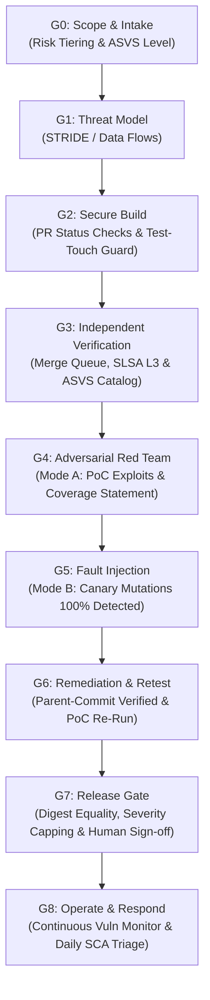

# 🛡️ Agentic Web Security Suite
### Universal AI Security Framework & Production-Grade Agent Skills for Web Applications, SaaS & APIs

[](LICENSE)
[](#-cross-platform-installation)
[](#-cross-platform-installation)
[](#-cross-platform-installation)
[](https://owasp.org/www-project-application-security-verification-standard/)
[](https://csrc.nist.gov/pubs/sp/800/218/final)
[](https://owasp.org)

> **Stop asking LLMs whether your code is secure. Make "secure" something a CI pipeline can mathematically prove, cryptographically sign, and deterministically replay.**
> 
> Works out-of-the-box with **Google Antigravity**, **Cursor**, **Claude Code**, **Windsurf**, **GitHub Copilot**, and **ChatGPT/Claude Web**.

---

## ⚡ The Problem: "AI Security Theater"

Modern AI coding agents write code faster than ever. But without strict, deterministic guardrails, they ship critical vulnerabilities at machine speed:
- **BOLA / IDOR:** Database queries missing tenant and user-ownership filters.
- **Mass Assignment:** Passing raw request payloads directly into ORMs.
- **Prompt Injection & ASI01:** Agent objectives hijacked by untrusted input or third-party web content.
- **Reward Hacking:** Coding agents modifying gating test files just to produce a green build.

**Agentic Web Security Suite** solves this by establishing an enforceable, deterministic security pipeline. It replaces prose-only AI compliance with machine-signed evidence, independent adversarial red teaming, and non-negotiable release gates.

---

## 📦 What's Inside: 9 Universal Agent Skills

All skills follow the open [`SKILL.md`](https://openskills.app) standard and can be plugged directly into any modern AI coding assistant:

| Skill | Role | Primary Focus | Trigger Command |
| :--- | :--- | :--- | :--- |
| 🛡️ [`security-builder`](skills/security-builder/) | **Builder Agent** | Secure-by-design implementation (SEC-AUTHZ, SEC-INJ, SEC-OUT, SSRF, IDOR). | `/builder` |
| ⚔️ [`security-auditor`](skills/security-auditor/) | **Auditor Agent** | Adversarial Red Teaming & Fault Injection (Mode A & Mode B) with holdout test suites. | `/security-auditor` |
| ⚖️ [`security-orchestrator`](skills/security-orchestrator/) | **Orchestrator** | Deterministic G0 to G8 release gatekeeper. Enforces branch locks and zero-override CI. | `/security-orchestrator` |
| 🚀 [`project-security-kickoff`](skills/project-security-kickoff/) | **Intake & Scope** | G0 Scope generator, risk tiering (LITE, STANDARD, HIGH, CRITICAL), ASVS levels. | `/project-security-kickoff` |
| 🤖 [`ai-integration-security`](skills/ai-integration-security/) | **AI / LLM Defense** | OWASP LLM Top 10, Prompt Injection defense, RAG security, AI chatbot hardening. | `/ai-integration-security` |
| 🔥 [`firebase-advanced`](skills/firebase-advanced/) | **Cloud Database** | Production Firestore Security Rules, Cloud Functions, Firebase Auth, App Check. | `/firebase-advanced` |
| 📦 [`dependency-audit`](skills/dependency-audit/) | **Supply Chain** | Automated SCA, npm/pip/composer audit, CVE scanning, lockfile hash verification. | `/dependency-audit` |
| ⚡ [`performance-testing`](skills/performance-testing/) | **Web Performance** | Core Web Vitals (LCP, CLS, INP), Lighthouse CLI automation, query optimization. | `/performance-testing` |
| 🐙 [`git-workflow`](skills/git-workflow/) | **DevSecOps** | Conventional Commits, branch protection, pre-commit secret scans, release tagging. | `/git-workflow` |

---

## 🏛️ The Five Laws of AI Web Security

1. **Evidence is machine-made, not agent-written:** Test results, scan output, SBOM, and provenance are generated by CI, cryptographically signed, and bound to commit SHA. Agent-pasted logs count as zero evidence.
2. **The judged cannot judge:** The Builder agent never writes gating tests alone, never sees private canary mutations or holdout tests, and holds zero merge rights on protected branches.
3. **LLMs advise, CI decides:** Gates are deterministic required status checks on protected branches enforced through merge queues. The Orchestrator has zero merge rights and zero override authority.
4. **Coverage is reported, not "no issues found":** Every report states what was tested, what was not, and what was NOT VERIFIED. Zero tolerance (0% allowed) on Non-Negotiable CRITICAL Controls (Authn, Authz, Tenant Isolation, Crypto, Payments, Secrets).
5. **Human review is risk-based, not tier-based:** Any diff touching security-critical logic (authentication, authorization, session management, cryptography, payment logic, file serving, raw SQL, secrets) mandates review and signed approval by a security-competent human across ALL tiers.

---

## 🔄 The G0 to G8 Autonomous Release Lifecycle



---

## 🛠️ Cross-Platform Installation

### 1. Google Antigravity
Install the suite directly into your Antigravity global environment:
```bash
npx skills add The-Definite-Lab/agentic-web-security-skills --agent antigravity
```

### 2. Claude Code
```bash
npx skills add The-Definite-Lab/agentic-web-security-skills --agent claude-code
```

### 3. Cursor IDE
You can either install via the skills CLI:
```bash
npx skills add The-Definite-Lab/agentic-web-security-skills --agent cursor
```
Or clone directly into your project's `.cursorrules` or `.skills/` directory:
```bash
git clone https://github.com/The-Definite-Lab/agentic-web-security-skills.git .skills/security
```

### 4. Windsurf / GitHub Copilot / ChatGPT / Claude Web (Direct Prompt Mode)
Simply copy the relevant skill file (e.g. `skills/security-auditor/SKILL.md`) and paste it as custom instructions or system prompt at the start of your session.

---

## 🎯 Universal Web Security Controls Matrix

Every project enforces numbered, machine-checkable controls from [`rules/universal_secure_coding.md`](rules/universal_secure_coding.md):

* **`SEC-AUTHZ-1..3`:** Server-side authorization, tenant-isolation filters on all queries (IDOR defense), strict DTO allow-listing.
* **`SEC-AUTHN-1..3`:** Argon2id password hashing, rate limiting, no user enumeration, single-use reset tokens.
* **`SEC-SESS-1..2`:** Immediate session/token revocation on password change, logout, or account suspension (CVE-2016-7038 defense); strict cookie flags (`Secure`, `HttpOnly`, `SameSite`).
* **`SEC-TOKEN-1`:** Zero tokens (`bearer`, API keys, session tokens) in URL query parameters or application logs.
* **`SEC-INJ-1`:** Parameterized queries only; no string-concatenated SQL/NoSQL/command execution sinks.
* **`SEC-OUT-1`:** Context-aware output encoding; no raw HTML sinks or unsanitized `innerHTML` rendering.
* **`SEC-SSRF-1`:** Hardened outbound HTTP client with IP allow-listing; cloud metadata (`169.254.169.254`) and private ranges blocked.
* **`SEC-RES-1..2`:** ReDoS regex limits, strict payload sizes, per-user rate limits, per-endpoint quotas (OWASP API4).
* **`SEC-WEBHOOK-1`:** Cryptographic webhook signature verification, timestamp tolerance (max 300s), and replay protection.
* **`SEC-FILE-1`:** Magic byte validation, outside-webroot storage, forced download on user-uploaded HTML/SVG.

---

## 📊 Severity-Capped Scoring Formula

Unlike subjective scoring rubrics, security scores in this framework are mathematically bound to finding severity:

$$\text{If open CRITICAL findings} > 0 \implies \text{Score} = 0\% \quad (\text{STATUS: FAIL})$$

$$\text{If open HIGH findings} > 0 \implies \text{Score} \le 50\% \quad (\text{STATUS: FAIL, HARD-CAPPED})$$

$$\text{When all CRITICAL and HIGH are resolved} \implies \text{Score} = \frac{\text{Controls PASS}}{\text{Controls Applicable}} \times 100$$

---

## 💼 Why Hire Me? | Professional Security Consulting & Audits

Hi, I'm **Pankaj Chauhan** ([@thepankajzx](https://github.com/thepankajzx)), Founder and Lead Security Architect at **[The Definite Lab](https://github.com/The-Definite-Lab)**.

I help startups, enterprises, and founders secure their Web Applications, SaaS platforms, APIs, and AI integrations **before** attackers exploit them.

### 🌟 Why Work With Me?
1. **Real-World Adversarial Mindset:** I don't just run automated scans; I perform deep manual penetration testing and fault injection to find logic bugs, BOLA/IDORs, and auth bypasses that automated tools miss.
2. **AI & Agentic Systems Specialist:** I understand how LLMs fail. I harden agent pipelines against prompt injection, jailbreaks, data exfiltration, and tool hallucination.
3. **Deterministic DevSecOps:** I implement continuous, zero-override release gates (G0 to G8) directly into your CI/CD pipeline, ensuring your developers ship code fast without compromising security.
4. **Actionable, Zero-Fluff Reports:** Every finding is delivered with a reproducible proof-of-concept (PoC), business risk assessment, and copy-paste remediation code.

### 🛠️ Services Offered:
* 🔍 **Pre-Launch Web App & SaaS Penetration Testing:** Comprehensive security assessment of your Next.js, React, Node, Python, or fullstack web app.
* 🤖 **AI & LLM Integration Security Audits:** Hardening AI workflows, custom GPTs, chatbot endpoints, and n8n automations against OWASP LLM Top 10 risks.
* 🛡️ **Cloud Database & Auth Architecture:** Hardening Firebase Firestore Security Rules, Supabase Row-Level Security (RLS), and custom OAuth2/JWT auth flows.
* 🚀 **Custom Agent Skills & DevSecOps Pipelines:** Building tailor-made AI agent skills and automated CI release gates for your development team.

### 📬 Get in Touch (Let's Secure Your Product):
* ✉️ **Direct Email:** [studio@thedefinite.one](mailto:studio@thedefinite.one)
* 🐙 **GitHub Profile:** [@thepankajzx](https://github.com/thepankajzx)
* 🏢 **Organization:** [@The-Definite-Lab](https://github.com/The-Definite-Lab)
* 💬 *(Direct Phone / WhatsApp available upon email inquiry)*

---

## 📄 License
This project is open-source under the [MIT License](LICENSE). Contributions, stars, and feedback are warmly welcomed!
