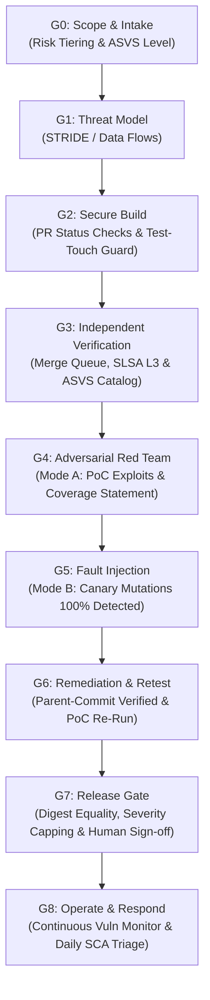

# 🛡️ Antigravity Web Security Suite
### Autonomous AI Security Framework & Agent Skills for Websites, SaaS & Web Applications

[](LICENSE)
[](https://openskills.app)
[](https://owasp.org/www-project-application-security-verification-standard/)
[](https://csrc.nist.gov/pubs/sp/800/218/final)
[](https://owasp.org)

> **Stop asking LLMs whether your code is secure. Make "secure" something a CI pipeline can mathematically prove, cryptographically sign, and deterministically replay.**

---

## ⚡ The Problem: "AI Security Theater"

AI coding assistants (Google Antigravity, Cursor, Claude Code, GitHub Copilot) write code faster than ever. But they also ship critical vulnerabilities at machine speed:
- **BOLA / IDOR:** Database queries missing tenant and ownership filters.
- **Mass Assignment:** Passing raw request bodies directly into ORMs.
- **Prompt Injection & ASI01:** Agent goals hijacked by malicious input or third-party data.
- **Reward Hacking:** Agents modifying gating test files just to produce a green build.

**This repository provides an enforceable, deterministic security framework and a suite of 9 production-grade Agent Skills specifically tailored for modern Websites, Web Applications, SaaS platforms, and APIs.**

---

## 📦 What's Inside: 9 Production-Grade Agent Skills

All skills follow the open [`SKILL.md`](https://openskills.app) standard and work seamlessly in **Google Antigravity**, **Cursor**, **Claude Code**, and agentic IDEs:

| Skill | Role | Primary Focus | Slash Trigger |
| :--- | :--- | :--- | :--- |
| 🛡️ [`security-builder`](skills/security-builder/) | **Builder Agent** | Secure-by-design implementation (SEC-AUTHZ, SEC-INJ, SEC-OUT, SSRF, IDOR). | `/builder` |
| ⚔️ [`security-auditor`](skills/security-auditor/) | **Auditor Agent** | Adversarial Red Teaming & Fault Injection (Mode A & Mode B) with holdout test suites. | `/security-auditor` |
| ⚖️ [`security-orchestrator`](skills/security-orchestrator/) | **Orchestrator** | Deterministic G0 to G8 release gatekeeper. Enforces branch locks and zero-override CI. | `/security-orchestrator` |
| 🚀 [`project-security-kickoff`](skills/project-security-kickoff/) | **Intake & Scope** | G0 Scope generator, risk tiering (LITE, STANDARD, HIGH, CRITICAL), ASVS levels. | `/project-security-kickoff` |
| 🤖 [`ai-integration-security`](skills/ai-integration-security/) | **AI / LLM Defense** | OWASP LLM Top 10, Prompt Injection defense, RAG security, AI chatbot hardening. | `/ai-integration-security` |
| 🔥 [`firebase-advanced`](skills/firebase-advanced/) | **Cloud Database** | Production Firestore Security Rules, Cloud Functions, Firebase Auth, App Check. | `/firebase-advanced` |
| 📦 [`dependency-audit`](skills/dependency-audit/) | **Supply Chain** | Automated SCA, npm/pip/composer audit, CVE scanning, lockfile hash verification. | `/dependency-audit` |
| ⚡ [`performance-testing`](skills/performance-testing/) | **Web Performance** | Core Web Vitals (LCP, CLS, INP), Lighthouse CLI automation, query optimization. | `/performance-testing` |
| 🐙 [`git-workflow`](skills/git-workflow/) | **DevSecOps** | Conventional Commits, branch protection, pre-commit secret scans, release tagging. | `/git-workflow` |

---

## 🏛️ The Five Laws of AI Web Security

1. **Evidence is machine-made, not agent-written:** Test results, scan output, SBOM, and provenance are generated by CI, cryptographically signed, and bound to commit SHA. Agent-pasted logs count as zero evidence.
2. **The judged cannot judge:** The Builder agent never writes gating tests alone, never sees private canary mutations or holdout tests, and holds zero merge rights on protected branches.
3. **LLMs advise, CI decides:** Gates are deterministic required status checks on protected branches enforced through merge queues. The Orchestrator has zero merge rights and zero override authority.
4. **Coverage is reported, not "no issues found":** Every report states what was tested, what was not, and what was NOT VERIFIED. Zero tolerance (0% allowed) on Non-Negotiable CRITICAL Controls (Authn, Authz, Tenant Isolation, Crypto, Payments, Secrets).
5. **Human review is risk-based, not tier-based:** Any diff touching security-critical logic (authentication, authorization, session management, cryptography, payment logic, file serving, raw SQL, secrets) mandates review and signed approval by a security-competent human across ALL tiers.

---

## 🔄 The G0 to G8 Autonomous Release Lifecycle



---

## 🚀 Quickstart & Installation

### Option 1: Install via Skills Runner (Recommended)
You can install these skills directly into your local agent environment using the standard skills runner:

```bash
# Add the entire security suite to your Antigravity agent
npx skills add thepankajzx/antigravity-web-security-skills --agent antigravity

# Or install for Claude Code
npx skills add thepankajzx/antigravity-web-security-skills --agent claude-code

# Or install for Cursor
npx skills add thepankajzx/antigravity-web-security-skills --agent cursor
```

### Option 2: Clone Directly into Your Project
```bash
git clone https://github.com/thepankajzx/antigravity-web-security-skills.git .skills/security
```

---

## 🎯 Universal Web Security Controls Matrix

Every project enforces numbered, machine-checkable controls from [`rules/universal_secure_coding.md`](rules/universal_secure_coding.md):

* **`SEC-AUTHZ-1..3`:** Server-side authorization, tenant-isolation filters on all queries (IDOR defense), strict DTO allow-listing.
* **`SEC-AUTHN-1..3`:** Argon2id password hashing, rate limiting, no user enumeration, single-use reset tokens.
* **`SEC-SESS-1..2`:** Immediate session/token revocation on password change, logout, or account suspension (CVE-2016-7038 defense); strict cookie flags (`Secure`, `HttpOnly`, `SameSite`).
* **`SEC-TOKEN-1`:** Zero tokens (`bearer`, API keys, session tokens) in URL query parameters or application logs.
* **`SEC-INJ-1`:** Parameterized queries only; no string-concatenated SQL/NoSQL/command execution sinks.
* **`SEC-OUT-1`:** Context-aware output encoding; no raw HTML sinks or unsanitized `innerHTML` rendering.
* **`SEC-SSRF-1`:** Hardened outbound HTTP client with IP allow-listing; cloud metadata (`169.254.169.254`) and private ranges blocked.
* **`SEC-RES-1..2`:** ReDoS regex limits, strict payload sizes, per-user rate limits, per-endpoint quotas (OWASP API4).
* **`SEC-WEBHOOK-1`:** Cryptographic webhook signature verification, timestamp tolerance (max 300s), and replay protection.
* **`SEC-FILE-1`:** Magic byte validation, outside-webroot storage, forced download on user-uploaded HTML/SVG.

---

## 📊 Severity-Capped Scoring Formula

Unlike subjective scoring rubrics, security scores in this framework are mathematically bound to finding severity:

$$\text{If open CRITICAL findings} > 0 \implies \text{Score} = 0\% \quad (\text{STATUS: FAIL})$$

$$\text{If open HIGH findings} > 0 \implies \text{Score} \le 50\% \quad (\text{STATUS: FAIL, HARD-CAPPED})$$

$$\text{When all CRITICAL and HIGH are resolved} \implies \text{Score} = \frac{\text{Controls PASS}}{\text{Controls Applicable}} \times 100$$

---

## 💼 Professional Security Services & Consulting

Are you building a Web Application, SaaS platform, E-commerce store, or AI-powered product and need to ensure it is rock-solid and secure before launch?

I provide professional security engineering and adversarial testing services:
* 🔍 **Web Application Penetration Testing & Red Teaming:** Finding IDORs, auth bypasses, business logic flaws, and injection sinks before attackers do.
* 🤖 **AI & LLM Integration Security Audits:** Hardening agents, prompt injection prevention, system prompt protection, and RAG data isolation.
* 🛡️ **DevSecOps & CI Release Pipeline Architecture:** Implementing deterministic release gates (G0-G8), signed SLSA provenance, and automated SAST/SCA/DAST pipelines.
* ☁️ **Cloud Database & Auth Hardening:** Production Firestore security rules, Supabase RLS policies, and OAuth/JWT architectures.

### 📬 Get in Touch:
- **GitHub:** [@thepankajzx](https://github.com/thepankajzx)
- **Discussions:** Feel free to open an issue or discussion on this repository for collaboration, enterprise consulting, or custom security skill development.

---

## 📄 License
This project is open-source under the [MIT License](LICENSE). Contributions, stars, and pull requests are warmly welcomed!
