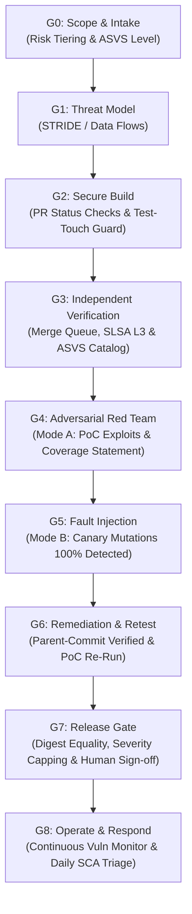

# Autonomous AI Security Framework for Web Applications & SaaS (v2.1)
## Deterministic, Machine-Enforced Security Pipeline for Coding Agents

> **Executive Summary:** A production-grade security architecture designed to constrain AI coding agents (Antigravity, Cursor, Claude Code, Copilot) when building websites, web applications, SaaS platforms, and mobile backends. 
> 
> It eliminates "LLM security theater" by transferring enforcement to deterministic CI gates, cryptographic evidence signatures, machine-checkable ASVS requirements, and risk-based human oversight.

---

## PART 1. The Five Laws of AI Web Security

1. **Evidence is machine-made, not agent-written.** Test results, scan output, SBOM, and build provenance are generated by CI, cryptographically signed, and bound to a commit SHA plus artifact digest (`sha256`). Agent-pasted terminal logs count as zero evidence.
2. **The judged cannot judge.** The Builder agent never writes gating tests alone, never inspects the Auditor's private canaries or holdout test suites, and holds zero merge or release rights on protected branches.
3. **LLMs advise, CI decides.** Gates are deterministic required status checks on protected branches enforced through merge queues. The Orchestrator agent verifies machine attestations and summarizes in plain language; it has zero merge rights and cannot waive failed checks.
4. **Coverage is reported, not "no issues found".** Every report states what was tested, what was not, and what was NOT VERIFIED. Zero tolerance (0% allowed) on Non-Negotiable CRITICAL Controls (Authentication, Authorization, Isolation, Cryptography, Payments, File Serving, Secrets).
5. **Human review is risk-based, not tier-based.** Any pull request modifying security-critical logic (authentication, authorization, session management, cryptography, payment/financial logic, file serving, SQL/database construction, secrets handling) mandates review and signed approval by a security-competent human across ALL tiers.

---

## PART 2. Web Application Risk Tiers

| Tier | Project Types | ASVS Level | Mandatory Baseline Controls |
| :--- | :--- | :--- | :--- |
| **LITE** | Internal admin tools, marketing landing pages, static blogs (No PII) | L1 (Lean) | Minimal lean control set: SAST, SCA, secret scan, basic authz/input validation tests, security headers, build verification, lightweight 1-page data-flow threat model. |
| **STANDARD** | Habit trackers, small SaaS, client portals, mobile app backends | L2 (L1 non-sensitive) | LITE + threat model (STRIDE), IDOR/BOLA suite, differential mutation tests on security-critical modules (70%), DAST baseline, privacy review, Auditor Mode A once per milestone. **Risk-based human review for security-critical diffs.** |
| **HIGH** | E-commerce with payment gateways, healthcare portals, university platforms | L2 + selected L3 | STANDARD + independent Auditor (different model vendor), private canary pool, Auditor-owned holdout tests, SBOM and signed provenance (SLSA L3), human security review, external pentest before first release. |
| **CRITICAL** | Fintech, payment gateways, banking APIs, citizen identity platforms | L3 | HIGH + full ledger and business-logic formal suite, compliance sign-off by a qualified officer, disaster recovery failover test, annual pentest. |

---

## PART 3. Roles and Independence Rules

| Role | Permitted Actions | Strictly Prohibited Actions |
| :--- | :--- | :--- |
| **Builder** | Write application code and unit/integration tests in feature branches via PR. Report broken tests via escalation tickets. | Merge to protected branches, view Auditor canary/holdout pools, hold production/signing credentials, edit CI gate configurations, modify `.github/workflows/` or `/security/`. |
| **Auditor** | Read repo, attack test deployments, plant mutations in throwaway forks, execute private holdout test suites. | Read Builder internal reasoning/prompts, accept Builder claims as proof, approve production releases. |
| **Orchestrator** | Verify CI signatures and attestations, track gate statuses, write plain-language operator summaries. | Merge code, waive checks, approve exceptions, accept unverified logs. |
| **CI & Merge Queue** | Run all test gates, execute holdout tests, sign evidence, enforce branch protection, re-run checks against target `main` HEAD. | Be bypassed by any actor (including admin). |
| **Human Reviewer** | Review security-critical diffs (risk-based across all tiers), sign risk acceptances, approve production releases. | Review code they authored or managed directly (mandatory Conflict-of-Interest declaration). |

---

## PART 4. Gates G0 to G8 (Deterministic Exit Criteria)

### G0: Intake and Scope
- Define application scope, target users, data classifications, assigned Risk Tier (LITE, STANDARD, HIGH, CRITICAL), ASVS level, test accounts, and named human reviewer.
- Signed commit required to exit.

### G1: Design and Threat Model
- Architecture map, data-flow diagram with trust boundaries, STRIDE model, authorization matrix, secrets and crypto strategy.
- Zero feature code written before G1 exits.

### G2: Secure Build (Feature PR Level)
- PR status checks green: lint, tests, SAST, SCA, secret scan, custom Semgrep rules.
- **Test-Touch Detection:** CI fails if a commit modifies both a feature file and its gating test file without Auditor sign-off.
- **AI Authorship Tracking (NIST SP 800-218A):** Every commit explicitly declares authorship via git trailers (`Co-authored-by: Agent`, `X-Authorship: AI`).
- Zero unapproved test skips (`@Ignore`, `skip`, `xfail`).

### G3: Independent Verification (CI-Side Build)
- **Branch Authorization Lock:** Artifact built exclusively from commits landed via GitHub/GitLab merge queue on protected branch.
- **Workflow Identity Pinning:** Release workflow file owned by human in `CODEOWNERS`; SHA256 digest matched against pre-approved hash lock.
- **Machine-Checkable ASVS Catalog Gate:** CI parses `/security/asvs_catalog.json` and fails build if any requirement for the selected level is unmapped or missing automated tests.
- **Differential Mutation Testing:** Run by isolated CI stage under separate signing key (STANDARD: 70%, HIGH: 80%, CRITICAL: 90%).
- SLSA Build L3 signed provenance and CycloneDX/SPDX SBOM.

### G4: Adversarial Red Team (Mode A)
- Fresh container session with signed isolation attestation (no previous transcripts or shared volumes).
- Auditor executes public + private attack vectors against test deployments.
- Output: Vulnerability findings with reproducible PoCs (synthetic data), severity ratings, and coverage statement.

### G5: Fault Injection / Canary (Mode B)
- Isolated throwaway fork. Rotating private canaries injected to verify detection capabilities.
- 100% of injected mutations must be detected.

### G6: Remediation and Retest
- **Parent-Commit Verification:** Regression test run against pre-fix parent commit to verify it fails (proves test efficacy).
- Auditor verifies PoC failure on new commit.

### G7: Release Gate and Sign-off
- **Severity-Capped Scoring:**
  - Any open CRITICAL finding $\implies$ **Score = 0% (FAIL)**.
  - Any open HIGH finding $\implies$ **Score $\le$ 50% (Hard Cap, FAIL)**.
  - All closed $\implies$ $\text{Score} = \frac{\text{Controls PASS}}{\text{Controls Applicable}} \times 100$.
- **Digest Equality:** Shipped artifact digest equals tested artifact digest (`tested_sha256 == shipped_sha256`).
- **Non-Negotiable CRITICAL Controls (0% NOT VERIFIED):** Authn, Authz, Tenant Isolation, Crypto, Payments, File Serving, Secrets.
- Overall NOT VERIFIED < 10% (STANDARD) or < 5% (HIGH/CRITICAL).
- Risk-based human code review signed for all security-critical diffs.

### G8: Operate and Respond
- `security.txt` published, triage SLA (acknowledge within 72h).
- Daily SCA re-scan with designated triage owner and false-positive suppression protocol (expiry max 30 days).
- Continuous monitoring of web framework advisories (Next.js, Express, FastAPI, etc.).
- Immutable release archive retention per NIST SSDF PS.3.

---

## PART 5. Universal Web Secure Coding Baseline (Numbered Controls)

| ID | Control | Verification Method |
| :--- | :--- | :--- |
| **SEC-AUTHZ-1** | Server-side authorization on every endpoint/action | BOLA/BFLA test suite, mutation |
| **SEC-AUTHZ-2** | Mandatory tenant/ownership filter in every user-scoped query (IDOR defense) | Automated IDOR matrix tests |
| **SEC-AUTHZ-3** | Mass assignment blocked (explicit allow-list DTOs / strong parameters) | Negative schema injection tests |
| **SEC-AUTHN-1** | Passwords hashed with Argon2id (or bcrypt cost ≥ 12); never reversible | Unit and configuration tests |
| **SEC-AUTHN-2** | Rate limiting, account lockout, no user enumeration on login/register/reset | DAST, automated boundary tests |
| **SEC-AUTHN-3** | Reset tokens single-use, short-lived, hashed at rest | Token lifecycle integration tests |
| **SEC-SESS-1** | Immediate token revocation on password change, forced logout, account suspension | Integration tests |
| **SEC-SESS-2** | Cookie flags: `Secure`, `HttpOnly`, `SameSite=Lax` or `Strict` | CI HTTP header validation |
| **SEC-TOKEN-1** | Zero bearer tokens, API keys, or session IDs in URL query strings or application logs | Semgrep rules + proxy log audit |
| **SEC-INPUT-1** | Allow-list validation, payload size limits, reject unknown fields | Fuzz and boundary testing |
| **SEC-INJ-1** | Parameterized queries only; no string-built SQL/NoSQL/command injection sinks | Semgrep taint analysis + CodeQL |
| **SEC-OUT-1** | Context-aware output encoding; no raw HTML sinks or innerHTML with user data | Semgrep, XSS test suites |
| **SEC-FILE-1** | Upload validation by magic bytes; stored outside web root; forced download for user HTML/SVG | Negative upload and mime tests |
| **SEC-SSRF-1** | Outbound requests through hardened client with allow-list; metadata/private IPs blocked | SSRF integration test suite |
| **SEC-REDIR-1** | Redirect targets validated against an allow-list or strictly local | URL redirect tests |
| **SEC-HDR-1** | CSP, frame-ancestors, X-Content-Type-Options, Referrer-Policy, HSTS, no wildcard CORS | Header scan in CI |
| **SEC-CRYPTO-1** | Vetted libraries, CSPRNG, TLS 1.2+ (1.3 preferred), no custom crypto algorithms | SAST, cipher suite configuration scan |
| **SEC-SECRET-1** | Zero secrets in code, config, or logs; vault/KMS integration; full git history scan | Secret scan (Gitleaks / TruffleHog) |
| **SEC-LOG-1** | Security events logged; PII/secrets redacted; correlation IDs; tamper-evident logs | Log output tests |
| **SEC-ERR-1** | Fail closed; no stack traces, database errors, or internal diagnostics to clients | Negative error handling tests |
| **SEC-RES-1** | Strict payload limits, nesting limits, pagination, upload count, ReDoS regex limits | Resource exhaustion tests |
| **SEC-RES-2** | Per-user rate limits, per-endpoint quotas, cost caps on expensive operations (AI, exports) | Rate limit & stress tests (OWASP API4) |
| **SEC-API-1** | API inventory maintained; shadow and deprecated routes removed; debug endpoints absent | Route reconciliation in CI (OWASP API9) |
| **SEC-WEBHOOK-1**| Inbound webhooks verified by cryptographic signature, timestamp tolerance, replay protection | Webhook test suite |
| **SEC-MAIL-1** | No email header injection; SPF, DKIM, and DMARC enforcement | Configuration audit |
| **SEC-IAC-1** | Scanned IaC; least-privilege IAM; no public storage buckets | Checkov / tfsec / Trivy |
| **SEC-SC-1** | Lockfiles with hashes, SBOM per release, signed build artifacts (SLSA L3) | CI provenance attestation |
| **SEC-PRIV-1** | Data minimization, retention policies, tested export and deletion flows (GDPR/DPDP) | Privacy API test suite |
| **SEC-LLM-1** | Untrusted input separated from system prompts; output treated as untrusted; tool allow-lists | Prompt injection test suite |

---

## PART 6. Web Application & SaaS Domain Addenda

### E-commerce & Payments (Tier HIGH)
- **Zero Card Storage:** Never touch raw card data. Use hosted checkout (Stripe Checkout / Elements / Razorpay).
- **Webhook Security:** Webhook signature verification, timestamp tolerance (max 300s), and replay protection are mandatory. The server webhook is the source of truth for payment status, NEVER the client return redirect.
- **Server-Side Pricing:** Price, discount, tax, currency conversion, and shipping must be computed exclusively on the server. The client sends only item ID and quantity.
- **Concurrency & Idempotency:** Idempotency keys on order placement and payment execution. Atomic inventory decrement. Enforce coupon limits per user and globally under concurrent race conditions.
- **Refund State Machine:** Refund amount cannot exceed captured amount; refund-after-refund blocked.

### SaaS & Mobile Backends (Tier STANDARD, IAP treated as HIGH)
- **Server-Side Receipt Validation:** Validate purchase tokens server-side with Google Play Developer API and Apple App Store Server API. Entitlements live on the server; client `isPro` flags are display-only.
- **Server Notifications:** Implement server-to-server endpoints for subscription renewals, grace periods, refunds, revocations, and cancellations.
- **Replay & Account Sharing:** Purchases tied to unique server account; prevent receipt replay across different accounts.
- **Offline Sync & Privacy:** Preserve ownership across account switching; logout purges local data and unsynced mutations.
- **AI Features:** User inputs treated as untrusted prompt data; PII redaction; tenant isolation; strict per-user cost caps.
